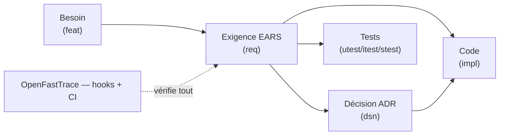

# alm-forge

**Dépôt-gabarit ALM : du besoin exprimé aux tests mécanisés, agnostique du
langage et de l'agent.**

[English summary](README.en.md)

alm-forge instancie en quelques minutes un projet où chaque ligne de code sait
pourquoi elle existe : besoins tracés, exigences rédigées sans ambiguïté
(EARS), décisions actées et protégées (ADR), traçabilité vérifiée
mécaniquement par [OpenFastTrace](https://github.com/itsallcode/openfasttrace)
en local et en CI, tests reliés aux exigences qu'ils prouvent. Le gabarit
s'applique sa propre méthode : sa spécification, ses ADR et sa traçabilité
verte sont la démonstration.

Il capitalise les pratiques éprouvées de deux dépôts de référence (ergonomia,
wallos-rs) et les référentiels du domaine : [MADR](https://adr.github.io/madr/),
[EARS](https://alistairmavin.com/ears/),
[Keep a Changelog](https://keepachangelog.com/fr/1.1.0/),
[Conventional Commits](https://www.conventionalcommits.org/fr/v1.0.0/).

## La chaîne

Chaque relation est déclarée dans les fichiers et vérifiée par l'outil : une
exigence sans test, un tag vers un identifiant inexistant ou une décision
manquante font échouer le commit et la CI. Aucune matrice tenue à la main.

À cette chaîne s'ajoute une seconde question, que la traçabilité ne pose
jamais : **le livré fait-il ce que l'exigence dit ?** C'est l'audit de
réalisation (`docs/audit/`) — verdicts écrits à la main, comptabilité générée.
La traçabilité mesure la présence, l'audit mesure la vérité ; un tag de
complaisance passe la première et échoue au second.

## Arborescence

| Chemin | Contenu |
| --- | --- |
| `docs/methode/` | La méthode, 15 chapitres normatifs |
| `docs/adr/` | Registre des décisions d'architecture |
| `docs/decisions/` | Relevés de séance et registre chronologique |
| `docs/audit/` | Audit de réalisation : le livré tient-il l'exigence |
| `docs/verification-manuelle/` | Procédures `mtest` — ce qu'aucune porte ne juge |
| `docs/todo/` | Feuille de route (index dérivé des fiches) |
| `docs/revues/` | Revues de code et leur suivi consolidé |
| `spec/01-besoins/` | Expressions de besoin (items feat) |
| `spec/02-exigences/` | Exigences EARS (items req) |
| `spec/open-questions.md` | Registre des blocages en attente d'arbitrage |
| `templates/fr/`, `templates/en/` | Modèles d'artefacts bilingues |
| `tools/` | Les portes qualité (scripts POSIX autonomes) — point d'entrée `ci.sh` |
| `tools/lexique.sh` | Le vocabulaire outillé, fr/en, figé à l'instanciation |
| `templates/forge/` | Automatismes d'issues prêts à câbler (non câblés ici) |
| `Taskfile.yml`, `.githooks/` | Façade d'orchestration (interchangeable, ADR-0007) et hooks |
| `.github/workflows/ci.yml`, `.gitlab-ci.yml` | Les mêmes portes en CI — façades par forge (ADR-0010) |
| `examples/demo-multi-langages/` | Chaîne complète en Python, Rust et shell |
| `AGENTS.md` | Contrat de travail, humains et agents IA |

## Démarrer un projet

1. Créer le dépôt sur la forge de votre choix : « Use this template » sur
   GitHub, ou simple clone + nouveau remote sur GitLab et toute autre forge
   git (les portes sont locales, la CI est fournie pour GitHub **et** GitLab,
   ADR-0010).
2. `task init -- --nom mon-projet --porteur "Prénom Nom"` (ou
   `sh tools/init.sh …`) : l'identité du projet est posée et trois arbitrages
   vous appartiennent — politique de mention de l'IA dans les commits
   (`--attribution-agents obligatoire|autorisee|interdite`, défaut :
   déclaration obligatoire avec responsable humain, ADR-0011), langue du
   dépôt (`--langue fr|en|fr-en`, ADR-0009). La spécification et les ADR propres au
   gabarit sont retirés, LICENSE/CHANGELOG/VERSION et registres réinitialisés,
   traçabilité laissée verte — aucune forge ne substituant de variables, ce
   script est la personnalisation.
3. Choisir l'orchestrateur : garder `Taskfile.yml` (défaut), le remplacer par
   la variante justfile de `templates/orchestrators/`, ou n'en garder aucun —
   les portes de `tools/` s'appellent aussi directement.
4. `task setup` — accueil du poste : bootstrap, hooks, puis l'état des portes.
   L'accueil **renseigne** : il rapporte le bilan sans jamais échouer dessus.
   C'est `task ci` qui sanctionne. (Chaque contributeur suivant fait de même
   après son clone.)
5. Écrire votre premier besoin (`templates/fr/need.md`) et l'ADR-0001 de votre
   projet (`task adr-new -- …`).
6. Étendre `tools/oft.sh` (périmètre scanné) et la CI aux répertoires de votre
   code, ajouter vos portes propres (lint, couverture, sécurité) — toute porte
   documentée est câblée, ou marquée « non câblée » avec raison et échéance.

## Commandes

| Commande | Effet |
| --- | --- |
| `task ci` | **Tout ce que la CI exécute** — voie constatée d'après le changement réel |
| `task setup` | Accueil après clone : bootstrap + hooks + portes |
| `task bootstrap` | Dépendances, flux consenti : socle + modules du projet (`tools/bootstrap.d/`) |
| `task trace` | Traçabilité complète (échoue si un maillon manque) |
| `task report` | Rapport HTML navigable dans `build/` |
| `task check` | Cohérence : ADR, parité des templates, version, index, lexique |
| `task liens` | Intégrité des liens internes de la documentation |
| `task audit` | Périmètre de l'audit de réalisation (`-- --squelette <domaine>`) |
| `task derive` | Anti-dérive des artefacts générés |
| `task regen` | Régénère feuille de route, suivi de revue, audit, badges |
| `task issues` | Conformité des issues (hors porte : réseau requis) |
| `task adr-new -- titre` | ADR suivant depuis le modèle |
| `task hooks` | Installe les hooks git |
| `task clean` | Nettoie les artefacts locaux (`-- --all` : cache d'outillage inclus) |

Chaque commande a son équivalent direct sans orchestrateur (`sh tools/oft.sh
trace`, `sh tools/checks.sh`…) : voir AGENTS.md §3.

Prérequis : git, un shell `sh` POSIX (fourni par Git sous Windows) — s'il
manque, `sh tools/install-git.sh` (Linux/macOS) ou
`powershell -ExecutionPolicy Bypass -File tools\install-git.ps1` (Windows),
le dépôt se récupérant sans git via l'archive d'export de la forge. Le reste
du socle (curl, Java 17+) se vérifie et s'installe, avec accord, par
`task bootstrap` (ADR-0014) ; [Task](https://taskfile.dev/) optionnel
(façade par défaut).

## Licence

[MIT](LICENSE).
