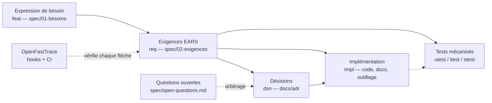

# La méthode alm-forge

Guide normatif du cycle de vie applicatif mis en œuvre par ce gabarit : du
besoin exprimé jusqu'aux tests mécanisés, indépendamment du langage du projet
et de l'agent (humain ou IA) qui produit le travail.

## Vue d'ensemble

Chaque flèche du schéma est une relation déclarée dans les fichiers (Covers,
Needs, tags de couverture) et **vérifiée mécaniquement** : si un maillon
manque, le commit et la CI échouent. Rien ne repose sur une matrice tenue à la
main.

## Les chapitres

| Chapitre | Objet |
| --- | --- |
| [1. Expression du besoin](01-expression-du-besoin.md) | Capturer le besoin et son intention avant toute exigence |
| [2. Exigences](02-exigences.md) | Rédiger selon EARS, niveaux normatifs, cycle de vie |
| [3. Décisions et ADR](03-decisions-adr.md) | Quand et comment acter une décision |
| [4. Traçabilité](04-tracabilite.md) | Syntaxe OpenFastTrace, tags, périmètre scanné |
| [5. Tests et vérification](05-tests-et-verification.md) | Pyramide, mécanisation, exigences non automatisables |
| [6. Questions ouvertes](06-questions-ouvertes.md) | Protocole de blocage et d'arbitrage |
| [7. Revue et recette](07-revue-et-recette.md) | Second regard, recette multi-rôles, sortie négative |
| [8. Versionnement et release](08-versionnement-release.md) | SemVer, Keep a Changelog, publication |
| [9. Gouvernance des agents](09-gouvernance-agents.md) | AGENTS.md, adaptateurs, règles vérifiées |
| [10. Sécurité continue](10-securite-continue.md) | STRIDE léger, vulnérabilités et exceptions, SBOM, porte anti-secrets |
| [11. Cycle de vie des issues](11-cycle-de-vie-issues.md) | État/attente/acte, flux Spec/Orga/réalisation, triage et priorités, fins de vie |
| [12. Feuille de route](12-feuille-de-route.md) | Fiches de chantier, statuts, index dérivé |
| [13. Statuts de spécification](13-statuts-de-specification.md) | Le commutateur qui commande le dénominateur des taux |
| [14. Audit de réalisation](14-audit-de-realisation.md) | Le livré tient-il l'exigence — le générateur compte, l'humain juge |
| [15. Cadrage des nouvelles fonctionnalités](15-cadrage-des-nouvelles-fonctionnalites.md) | L'amont du circuit : de la demande éparse à la proposition |
| [16. Validation des écrans](16-validation-des-ecrans.md) | Trois étages mécanisés ; l'humain garde le veto et le goût |

## Principes transverses

1. **Les bonnes pratiques priment sur la rapidité.** Un raccourci qui coûte de
   la qualité se paie avec intérêts ; déroger exige une décision explicite.
2. **Tout contrôle est mécanisé ou n'existe pas.** Une règle documentée sans
   outil qui la vérifie est un vœu ; une porte déclarée mais non câblée est un
   mensonge de conformité.
3. **Un contrôle qui passe toujours est pire que pas de contrôle** : il tient
   lieu de garantie. Tester le cas d'échec d'une porte fait partie de sa mise
   en place.
4. **Quatre artefacts, quatre rôles** : la spécification porte le contenu,
   l'issue porte la coordination, le relevé porte la décision, la matrice de
   traçabilité porte la vérification. Ne pas les mélanger.
5. **On ne réécrit pas l'histoire** : ADR accepté, relevé figé, question
   ouverte résolue, section de journal publiée restent en l'état ; on les
   remplace ou on les complète par addendum daté.
6. **La présence n'est pas la vérité.** La traçabilité mesure qu'un maillon
   existe (ch. 4) ; l'audit mesure qu'il fait ce qu'il annonce (ch. 14). Les
   deux sont nécessaires, et aucun ne remplace l'autre.
7. **Un index ou un tableau de bord se dérive, il ne se tient pas.** Tout
   artefact qui recopie une information qui vit ailleurs finit par mentir :
   il se génère, et la porte anti-dérive interdit de le retoucher (R8).
